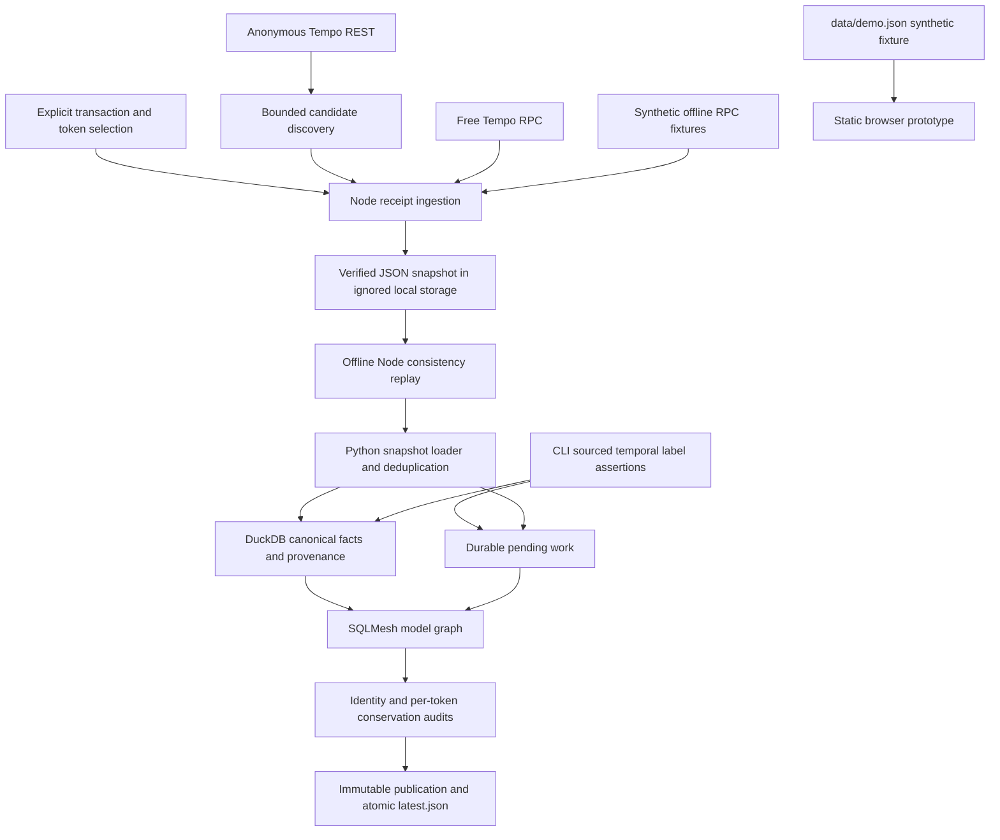
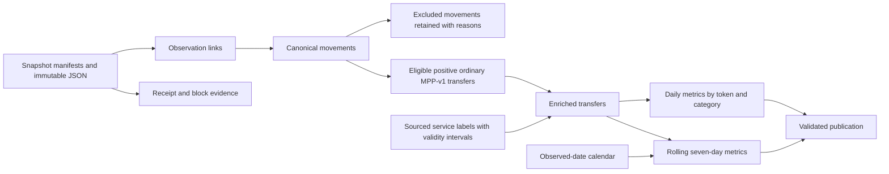
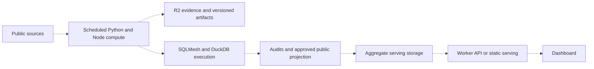

# System diagrams

These diagrams describe the implemented local system unless explicitly marked proposed. [Start here](START_HERE.md) provides runnable commands; [technical design](TECHNICAL_DESIGN.md) owns detailed contracts.

## Acquisition, modeling and serving boundary



There is currently **no edge from publication to browser**. Node checks as-acquired finality and receipt/block consistency. Replay checks that saved derived data agrees with saved evidence; neither step supplies cryptographic proofs or complete-chain coverage. A separate warehouse per source mode prevents live/synthetic mixing.

The [durable acquisition coordinator](INGESTION.md) now checkpoints discovery windows and receipt batches in SQLite, then invokes this same snapshot/SQLMesh boundary. Its ledger includes empty and unfinished windows; publication provenance includes imported windows only.

## Logical storage relationships



Canonical identity is `(chain_id, transaction_hash, canonical_transfer_log_index)`. Two event representations of the same transfer merge during normalization; separate equal payments retain separate identities. Multiple observations link to one canonical fact. Conflicting evidence rejects import rather than replacing history silently.

The current service-label table is narrow. Generic temporal attributes, relationships, mapping conflicts and corrections are future work in [the platform plan](DATA_PLATFORM.md). A server fingerprint is not a resolved operator. Client presence, client identity/role and originating interface are separate questions; the current models keep interface unknown.

## Historical label update and recovery

```mermaid
sequenceDiagram
    actor Caller
    participant CLI as Python workflow
    participant DB as DuckDB
    participant Mesh as SQLMesh
    participant Files as Publications
    Caller->>CLI: add-label with source and validity interval
    CLI->>CLI: Acquire writer lock and validate assertion
    CLI->>DB: Commit label and pending change together
    CLI->>DB: Find affected activity dates
    CLI->>Mesh: Explicit restatement of enriched transfers
    Mesh->>DB: Rebuild affected daily data and full rolling model
    CLI->>DB: Audit identities, counts and token totals
    alt Build and audits succeed
        CLI->>Files: Write immutable artifact and replace latest atomically
        CLI->>DB: Acknowledge pending work
    else Build, audit or publication fails
        CLI-->>Caller: Error; pending work retained
        Note over DB,Files: Previous publication remains the serving version
        Caller->>CLI: resume
        CLI->>Mesh: Retry pending restatement
    end
```

SQLMesh does not poll external labels for this workflow. The wrapper owns source-change detection and publication. Rolling is a FULL model so a change also reaches subsequent windows. Snapshot imports conservatively restate the full bounded observed span. One local writer is serialized with `fcntl`; no distributed lock or cross-model atomic database swap is claimed. A crash after publication but before acknowledgment is safe to retry.

## Proposed cloud deployment — not implemented



R2, an optional D1 serving layer, and Workers are candidates, not deployed components. Compute, scheduling, production SQLMesh state, locking, backups and publication policy must be selected before implementation. Do not treat an object-store DuckDB file as a shared writable database. Full local publications include evidence; a separate approved public projection is required before publishing. See [Cloudflare readiness](CLOUDFLARE.md).
