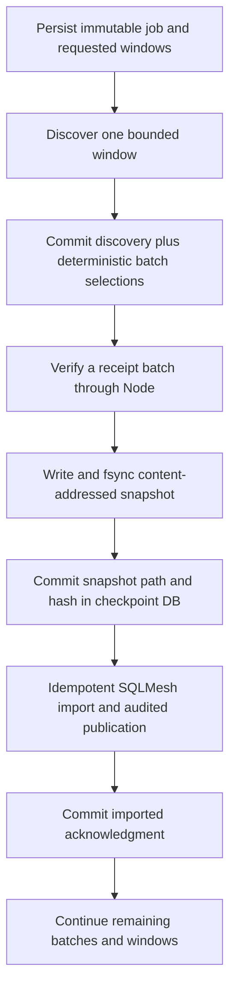

# Durable ingestion and recovery

The coordinator in `analytics/ingestion.py` connects bounded Node discovery/receipt acquisition to the existing idempotent SQLMesh loader. Use the pinned Python environment from [Start here](START_HERE.md). It requires Node 22+, Python 3.13 and local POSIX storage/locking. No wallet or paid endpoint integration is used.

## Start a bounded job

Create `.local/window.json` using the same discovery fields as the [root README](../README.md#ingestion-and-tests): `chainId` (`"4217"` or `"42431"`), inclusive integer `fromBlock` and `toBlock`, and `tokens` (1–20 actual native TIP-20 addresses). Select a fixed finalized interval and a free RPC endpoint. Optional controls:

| Field | Default | Limit / purpose |
| --- | --- | --- |
| `windowBlocks` | 100 | 1–1000 blocks per discovery window |
| `batchSize` | 25 | 1–100 transactions per verified receipt snapshot |
| `maxPages` | 10 | 1–20 REST pages per window; 50 rows per page |
| `observationKey` | `initial` | 1–80 letters/digits/underscores/hyphens; change to intentionally re-observe the same range |

A job spans at most 10,000 blocks and 1,000 windows. Discovery remains limited to 100 selected transactions **per window**, regardless of batch size. Narrow dense windows if this or the page limit is exceeded; automatic splitting and unbounded backfills are not implemented. A single block exceeding the discovery limit needs a future acquisition strategy.

```sh
TEMPO_RPC_URL=https://YOUR_FREE_PUBLIC_TEMPO_RPC \
  .local/venv/bin/python -m analytics.ingestion --home .local/ingestion \
  start .local/window.json --warehouse .local/live-analytics
```

Use a verified-snapshot warehouse or a fresh directory, never an `init-demo` warehouse. Synthetic and live data still cannot mix. Checkpoint home and warehouse must differ. Keep both in ignored `.local/`. The checkpoint stores the resolved warehouse path; moving a warehouse requires a future explicit relocation procedure. It stores only the RPC origin, never endpoint paths, queries, credentials or provider error bodies.

The job identity includes normalized config, source origin, source mode and warehouse path. Resubmitting identical inputs resumes the same job; a completed job is a no-op. Expand bounds to create an overlapping/new job. Change `observationKey` to intentionally recheck the exact same interval later for indexer lag. These repeated observations add provenance, while canonical payment keys prevent metric duplication.

## Inspect and resume

```sh
.local/venv/bin/python -m analytics.ingestion --home .local/ingestion status
TEMPO_RPC_URL=https://YOUR_FREE_PUBLIC_TEMPO_RPC \
  .local/venv/bin/python -m analytics.ingestion --home .local/ingestion resume JOB_ID_FROM_STATUS
```

`status` needs no network or credentials. It reads a consistent, read-only database snapshot without taking the acquisition writer lock, so it can monitor an active run. A nonexistent store is an error, not an empty newly created database. It reports every requested window, completed discovery metadata, verified/imported batch counts, empty windows and unfinished work. Output contains acquired candidate identifiers: keep any redirected output in `.local/`, not Git. A failed command leaves its registered job discoverable through `status`; if failure preceded registration, resubmit `start`.

A pending job rechecks the pinned range-end block hash against the expected chain and current finalized height before proceeding. Changed anchors stop for explicit reconciliation. Completed jobs do not make network calls or claim fresh finality. Already imported batches retain their as-acquired verification; checkpoint recovery is not a continuous reorg monitor.

## Checkpoint boundaries



- Interrupted pagination restarts **that window** from its first page. We do not persist provider cursor tokens, which may expire. Completed windows' discovery and their batch selections are reused.
- An interrupted receipt acquisition repeats only its uncheckpointed batch. Completed snapshots are reused with SHA-256 integrity checks.
- A crash after publication but before acknowledgment repeats the saved snapshot import. The existing loader makes this idempotent. Failed builds keep the previous publication and pending model work.
- Empty discovered windows are recorded as completed discovery with zero batches; no fake empty payment snapshot is created.
- Each successful batch can publish independently. A job is not an atomic whole-range publication. Consult checkpoint status for unfinished windows; a current publication may contain only a subset of the requested job.
- SQLite transactions (`synchronous=FULL`) protect checkpoint transitions. Snapshot files are flushed, fsynced and atomically renamed before DB references commit. A local advisory writer lock releases when the process exits, including abrupt termination. Orphan snapshots from pre-commit crashes are harmless; no automatic garbage collector exists yet.

Back up the checkpoint directory and warehouse together while idle. Snapshot integrity failures, changed chain evidence or source-mode mismatches stop rather than silently replace history. This is a local single-writer design, not a distributed/cloud transaction protocol.

## Coverage and provenance

`work_complete` and `status: complete` describe completed requested work, **never verified chain completeness**. Pagination exhaustion may coexist with indexer lag, missing history and token/transaction selection bias. Range/day completeness remains false; an empty window does not prove zero chain activity. Completed windows are not used to skip overlapping jobs.

Each imported snapshot carries validated `discoveryContext` linking its job/window, requested bounds, discovery time, page/row counts and candidate count into SQLMesh's source manifests. This is acquisition provenance, not independent chain evidence. The full checkpoint ledger retains empty and pending windows; SQLMesh publications contain provenance only for imported snapshots. Existing standalone v1 snapshots remain supported without discovery context.

## Verification

```sh
node --test test/*.test.mjs
.local/venv/bin/python -m unittest discover -s analytics/tests -v
```

Synthetic integration tests force an abrupt process exit after real SQLMesh publication, resume from saved evidence, interrupt discovery/receipt/import stages, overlap ranges and intentionally re-observe a range. They assert unchanged daily/rolling totals, distinct canonical facts and additional observation links. Other tests reject changed range anchors, corrupted snapshots and incompatible sources. No live acquisition or paid requests are needed for validation.
